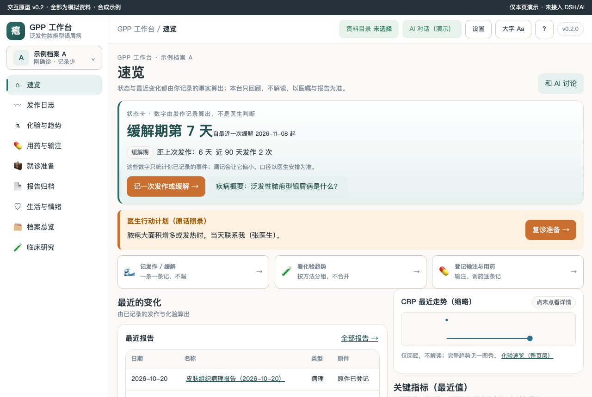
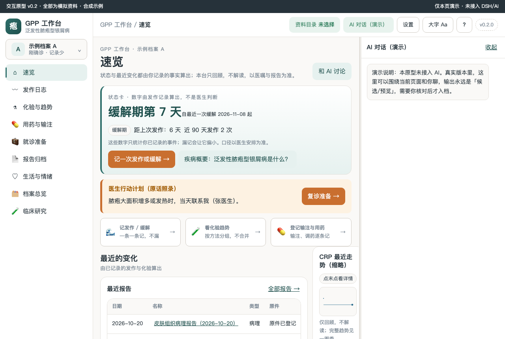
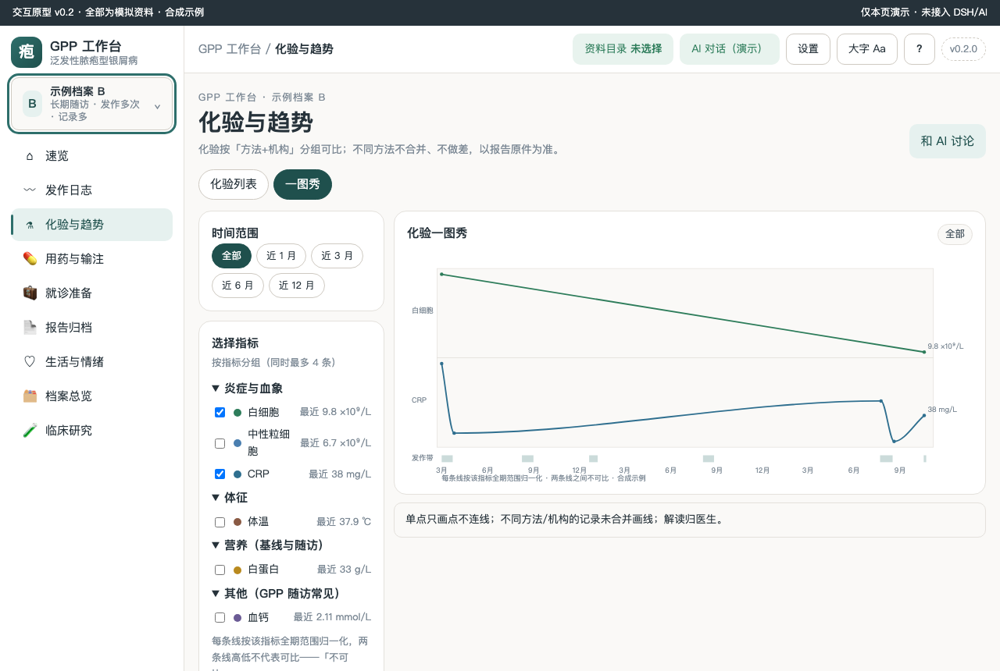
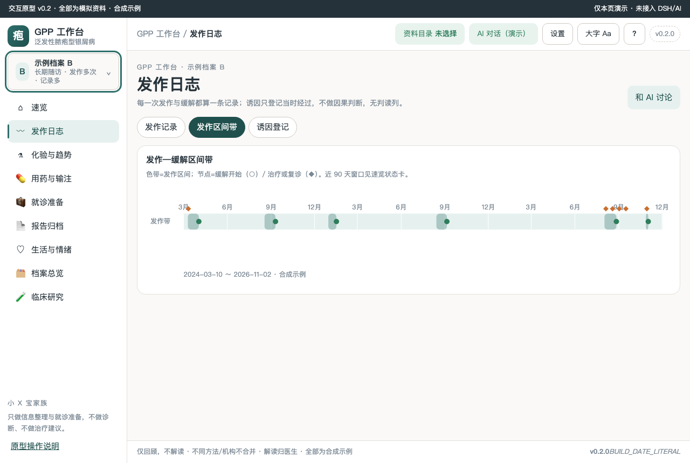
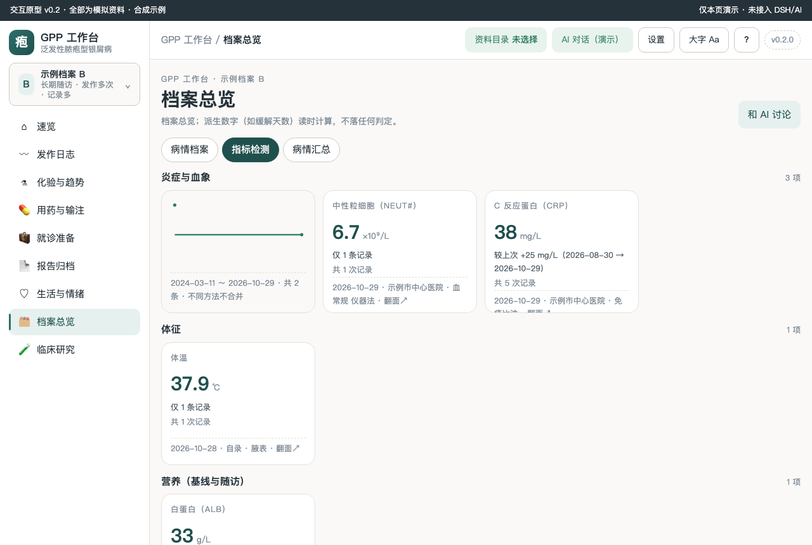
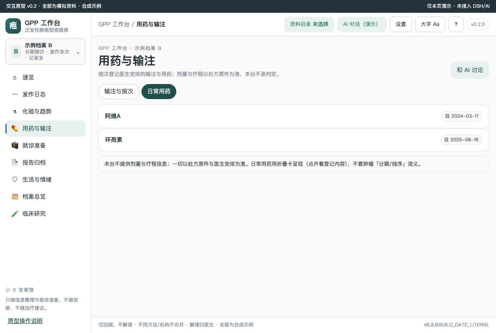
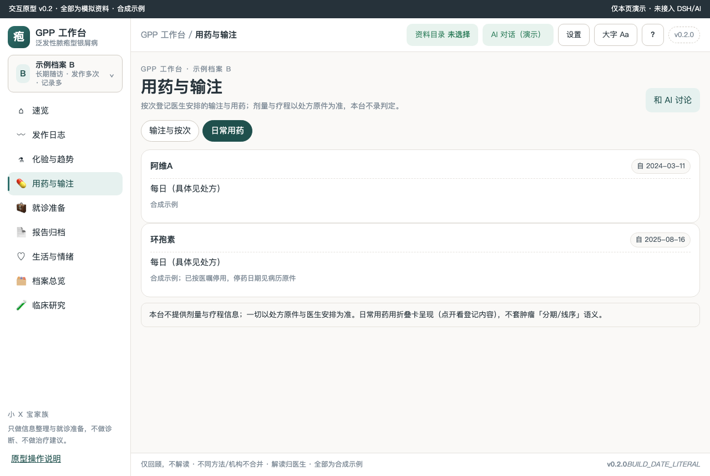
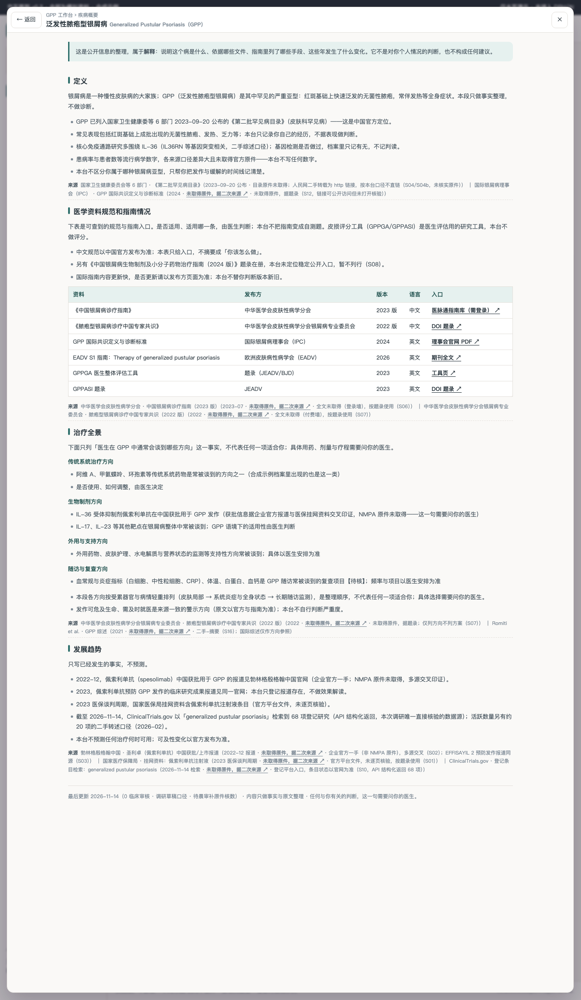
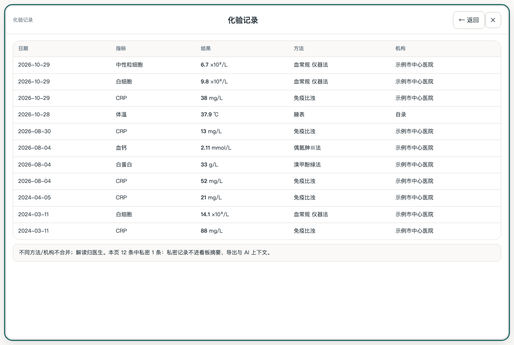
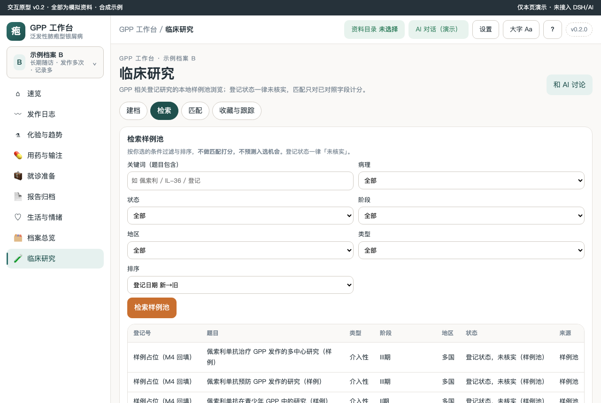

# GPP 工作台 · 泛发性脓疱型银屑病（GPP）患者与照护者工作台

本机优先的泛发性脓疱型银屑病（Generalized Pustular Psoriasis，GPP）病程资料工作台：把散落的发作与缓解记录、体温与血象炎症化验、皮损与病理报告、生物制剂与传统系统治疗用药登记，整理成可核对、可回溯的发作时间轴，并在复诊前整理成能带着走的问题清单。服务对象是 GPP 患者与照护者；本台只做信息整理与就诊准备，不做诊断、不做治疗建议。

当前状态：M2 原型（`prototypes/v0.2`）与 DSH 接入骨架同仓，`npm run check` 与 `npm test` 全绿（35/35）。页面全部为合成示例资料，未接入 DSH/AI，界面文案已如实标注。

## 疾病概要

顶栏「?」或速览页状态卡内的「疾病概要：泛发性脓疱型银屑病是什么？」按钮，随时打开整页面板（`#disease-primer`）。四段固定结构，每段带来源行（原件 / 官方入口 / 二次来源 / 未取得，分开标注）；快照日期 2026-11-14；逐条来源与核验状态见 [docs/SOURCES-LEDGER.md](docs/SOURCES-LEDGER.md)。四段一句话摘要：

### 定义

银屑病家族中罕见且严重的亚型，红斑基础上迅速泛发无菌性脓疱、常伴发热等全身症状；GPP 已列入国家卫生健康委等 6 部门 2023-09-20 公布的《第二批罕见病目录》。本段只做事实整理，不做诊断，也不区分你属于银屑病哪一亚型。
### 医学资料规范和指南情况

列出可查到的规范与指南入口（《中国银屑病诊疗指南》2023 版、脓疱型银屑病诊疗中国专家共识 2022、IPC 2024 国际共识定义与诊断标准、EADV S1 2026 等），是否适用、适用哪一条由医生判断，本台不把指南变成自测题。
### 目前治疗全景概要

只列「医生在 GPP 中通常会谈到哪些方向」这一事实——传统系统治疗方向、生物制剂方向（IL-36 通路）、外用与支持方向、随访与复查方向；不代表任何一项适合你，具体用药、剂量与疗程需要问你的医生。
### 发展趋势

只写已经发生的事实、不预测（如 2022-12 佩索利单抗中国获批用于 GPP 的报道见企业官方渠道、ClinicalTrials.gov 以 "generalized pustular psoriasis" 检索到 68 项登记研究等）；可及性变化以官方发布为准。

## 五条红线声明

1. **不诊断、不判读**：本台只做事实整理与回顾；所有解读归医生。状态卡数字由你记录的发作事件算出，不是医生判断；诱因只登记当时经过，不做因果判断。
2. **数据不出设备**：本机优先。演示档案全部为合成示例；MinerU 文档解析未勾选不上传；AI 面板为演示态（草稿只填不发），未接通明说。
3. **来源可追溯**：疾病概要每段带来源行，按「原件 / 官方入口 / 二次来源 / 未取得」四态分开标注；调研逐条记录在 [docs/SOURCES-LEDGER.md](docs/SOURCES-LEDGER.md)（含失败记录，如 NMPA 官网未取得）。
4. **无判读列**：发作日志、诱因登记、用药与输注登记都没有「疗效/因果」类判读列；不同方法/机构的化验不合并、不做差。
5. **0 访谈、0 临床审核，如实标注**：场景句为改写描述、标注待验证；阈值、疗程、可及性一律【待核】；页面无「未接入占位」式假完成，通道终态（含失败）如实显示。

## 截图墙（真实渲染，1280×860，playwright 实截）

### 1. 速览看板（示例档案 A · 刚确诊记录少）

状态卡「缓解期第 7 天 · 距上次发作 6 天 · 近 90 天发作 2 次」由发作记录算出；医生行动计划只照录原话；迷你 CRP 走势只画点不连线，末点可点开详情。

### 2. AI 面板打开态（右侧 35%，可拖 25–45%）

演示态：草稿只填入输入框、不自动发送，发送键禁用；未接通 AI 如实写明。

### 3. 化验一图秀（示例档案 B · 长期随访）

每条线按该指标全期范围归一化，线与线之间「不可比」；按「方法+机构」分组，不同方法不合并画线；发作带开关只影响底色不改数据线。

### 4. 发作区间带（示例档案 B）

色带=一次发作区间，圆点=缓解开始，菱形=治疗或复诊；非肿瘤语义，无 D+N 天数列。

### 5. 指标卡 3D 翻转态（档案总览 · 指标检测）

正面：最近值 / 与前次差值 / 检测次数 / 来源；背面：走势缩略图。翻转不改变栅格布局。

### 6. 用药折叠卡收起态（用药与输注 · 日常用药）

原生 `details` 折叠卡呈现日常用药（阿维A / 环孢素）；剂量与疗程以处方原件为准，本台不录判定。

### 7. 用药折叠卡展开态

展开后显示登记内容与备注；打印与键盘语义保留。

### 8. 疾病概要整页面板（顶栏「?」/ 速览状态卡入口）

四段 definition / evidence / landscape / trend 全部可见，每段带来源行；底部注明快照日期与「任何与你有关的判断，这一句都要问你的医生」。

### 9. 整页视图（化验记录层）

返回 / 关闭双入口、Esc 一层一退、history 为导航栈唯一真源；导出预览与看板摘要、AI 上下文共用同一私密过滤。

### 10. 临床 · 检索页（含候选池口径卡头）

多条件过滤与排序、不做匹配打分、不预测入选机会；卡头明示候选池口径「已载 10 条（本地样例池，真实结构、非全库、不含可用登记号）；登记状态一律未核实」。

## 快速开始

要求 Node.js 22+（独立启动用）；直接浏览原型则只需任意现代浏览器。

```bash
# 1) 直接打开原型（file:// 可用，全部为合成示例）
open prototypes/v0.2/index.html

# 或起本地静态服务后访问 http://127.0.0.1:8899/
python3 -m http.server 8899 --directory prototypes/v0.2

# 2) 独立启动开发版（同宿主同一份 Workbench；本机目录由用户明确指定）
npm start -- --root <你的资料目录>

# 3) 检查链与单测（当前全绿）
npm run check   # 静态检查链（含探针覆盖、版本同源、ui-parity 等断言）
npm test        # 单测（35/35 通过）
```

侧栏「切换档案」可换示例档案 A（刚确诊 · 记录少）/ B（长期随访 · 发作多次 · 记录多），切换后整页联动，会话与草稿按档案隔离；也可「新建我的档案」（演示档案不会被改动）。

## 数据与试验口径

- **演示数据唯一源**：`prototypes/v0.2/demo-data.js`（两套合成档案；页面不写死业务数字，派生值读时计算）。
- **原型页样例池**：10 条（本地样例池，真实结构、非全库、不含可用登记号），登记状态一律「未核实」。
- **M4 快照**：`research/gpp/trials-2026.jsonl` 共 11 条（快照日期 2026-11-14）；chictr/ictrp 两通道失败未补采，失败记录见 `research/gpp/FAILED.md`，正式池扩充待 M4 复跑或接入 CT.gov 独立口径。
- **ClinicalTrials.gov 独立口径**：68 项登记研究（API v2 `query.cond=generalized pustular psoriasis` + `countTotal=true`，检索日期 2026-11-14；含干预与观察性，全时间段全地域），未入池，见 [docs/SOURCES-LEDGER.md](docs/SOURCES-LEDGER.md) S10。
- **匹配口径**：只对已确认入库且样例池已结构化的字段计分（目前仅疾病相关性与研究类型偏好两项）；年龄、性别、化验值未结构化，参与会造出假分数，正式快照接入前不开放【待核】；药物靶点即使有也不进分母。

## 目录结构速览

```
prototypes/v0.2/   交互原型（index.html + app.js + demo-data.js + primer.js 等，实截截图的来源）
public/            DSH 客户端静态产物（由原型经白名单替换点生成，ui-parity 断言兜底）
dsh/  lib/  src/   DSH 接入骨架：Workbench / server / store / readmodels / client
schema/            SQLite 迁移（0001 初始表、0002 应用设置、freeze-contract）
research/gpp/      试验快照与采集台账（manifest / trials-2026.jsonl / FAILED.md）
docs/              设计文档（含 SOURCES-LEDGER 来源台账、35-TRIAL-MATCHING、36-DISEASE-PRIMER 等）
scripts/           检查链与探针（check-* / probe-* / dev-server 等）
test/              单测（ui-parity、demo-parity、store-migrate、api-base 等）
```

## 版本

0.2.0（与 `VERSION`、`package.json` 三处同源，`npm run check` 内含断言）。变更记录见 [CHANGELOG.md](CHANGELOG.md)；原型验收与里程碑见 [docs/DEV-PLAN.md](docs/DEV-PLAN.md) 与 [PROGRESS.md](PROGRESS.md)。
